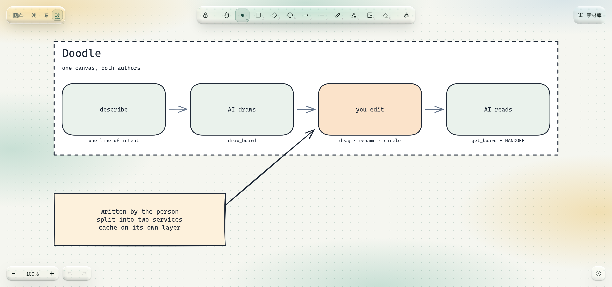

# Doodle

<p align="center">
  <strong>Stop describing layouts and architectures in 500 words of prompt text.</strong><br/>
  A local-first <strong>two-way</strong> Excalidraw whiteboard where you and your AI agent draw together, edit each other's work, and sync intent directly over MCP.
</p>

<p align="center">
  <a href="https://www.npmjs.com/package/doodle-mcp"></a>
  <a href="https://github.com/2648782102/Doodle/blob/master/LICENSE"></a>
  <a href="https://github.com/2648782102/Doodle/actions"></a>
  <br/>
  <a href="README.md">简体中文</a> | <strong>English</strong>
</p>

> A local-first two-way board where people and AI draw to express intent through MCP.

<p align="center">
  
</p>

Doodle has one kernel: **one infinite board shared by a person and an AI**. The AI draws through MCP tools inside the agent; the person draws directly on the canvas. Either side can continue or revise what the other left behind, and the board itself is the medium. Conversation stays in the host chat — Doodle creates no second session.

```text
AI draws with draw_board  ──▶  You edit / sketch / annotate directly on Excalidraw
         ▲                                              │
         │                                              ▼
AI reads HANDOFF delta    ◀──  Final state syncs to chat context (or click "通知 Agent")
```

There are two entry points: **direct MCP / `npx`** (any host, no clone) and the **Codex plugin** (recommended for Codex users, one command). Host capability has three layers: the four tools always work; MCP Apps hosts show the same canvas beside the chat; hosts with `updateModelContext` / `sendMessage` add automatic final-state sync and a short notification. When a host cannot render the canvas, `PANEL_URL` from `get_board` is the local fallback page.

Since `0.8.0` the legacy DOM canvas is gone and **Excalidraw is the only human-facing canvas**. Board v1 remains the sole persisted state and the AI-authoritative contract; Excalidraw elements are derived from it on every render, with no second canvas state.

## Why Doodle?

Most "diagram MCPs" only work one way: the AI generates a static picture or dumps shapes, and if something is wrong, you are back to typing paragraphs to fix it. Doodle connects human edits back into the agent loop:

- **True two-way `HANDOFF` sync**: When you drag, rename, or cross something out on the board, Doodle computes what *you* changed (ignoring the AI's own previous writes) and syncs the final state back to the agent.
- **Only 4 focused tools**: `get_board`, `show_board`, `draw_board`, and `scan_project`. Minimal context window overhead compared to 20+ tool servers.
- **Zero-config & 100% local-first**: Runs via `npx -y doodle-mcp` with **no API keys, no cloud accounts, and no telemetry**. Board state stays in local `.doodle/board.json`.
- **Works in any MCP client**: Renders inline in MCP Apps hosts (Codex, Claude Desktop, Cursor, VS Code), and automatically provides a local browser `PANEL_URL` fallback for terminal/text-only hosts.
- **Powered by Excalidraw (`0.8.0+`)**: Full hand-drawn rendering, freehand ink & stroke eraser, multi-select, image paste (`Ctrl/⌘+V`), local editable board library (`图库`), and PNG/JPG/SVG snapshot exports.

### How Doodle compares

| Feature | **Doodle (`doodle-mcp`)** | Typical Diagram MCPs |
|---|---|---|
| **Interaction model** | **Two-way** (AI draws + human edits sync back via `HANDOFF` & `updateModelContext`) | Mostly one-way (AI outputs diagram; human edits require screenshots or re-prompting) |
| **MCP tool surface** | **4 tools** (low prompt & token overhead) | Often 15–26+ tools |
| **Setup & API keys** | **`npx -y doodle-mcp`**, zero config, no API keys | Often requires API keys, Docker, or cloning |
| **Fallback for CLI hosts** | Built-in local Excalidraw `PANEL_URL` server | Usually UI-less or fails without webview |
| **License & status** | **MIT License**, actively maintained | Varies (some lack a license file or are archived) |

## 30-second start

**Any MCP host (`npx -y doodle-mcp`, no clone required)**

Add the zero-configuration snippet for your host (also stored in [examples/mcp-config/](examples/mcp-config/)), restart the MCP session, and say: **"Open the Doodle board so we can communicate on it."** This path needs no repository clone and does not imply public plugin-directory publication.

<details open>
<summary><strong>Claude Code (CLI)</strong></summary>

```bash
claude mcp add doodle -- npx -y doodle-mcp
```

</details>

<details>
<summary><strong>Cursor (<code>.cursor/mcp.json</code> or <code>~/.cursor/mcp.json</code>)</strong></summary>

```json
{
  "mcpServers": {
    "doodle": {
      "command": "npx",
      "args": ["-y", "doodle-mcp"]
    }
  }
}
```

</details>

<details>
<summary><strong>Claude Desktop (<code>claude_desktop_config.json</code>)</strong></summary>

```json
{
  "mcpServers": {
    "doodle": {
      "command": "npx",
      "args": ["-y", "doodle-mcp"]
    }
  }
}
```

</details>

<details>
<summary><strong>VS Code (<code>.vscode/mcp.json</code>)</strong></summary>

```json
{
  "servers": {
    "doodle": {
      "type": "stdio",
      "command": "npx",
      "args": ["-y", "doodle-mcp"]
    }
  }
}
```

</details>

<details>
<summary><strong>Codex CLI / App (<code>.codex/config.toml</code>)</strong></summary>

```toml
[mcp_servers.doodle]
command = "npx"
args = ["-y", "doodle-mcp"]
```

</details>

**Want to share the board with an AI (Codex plugin, recommended for Codex users)**

```bash
npm run setup:codex
```

One command installs dependencies, builds the self-contained plugin, registers this repository as a local marketplace, installs `doodle@doodle`, and prints the first prompt. **Start a new Codex session**, then say:

```text
Open the Doodle board so we can communicate on it.
```

MCP Apps hosts show the canvas beside the chat; the AI reads the board first, then draws a starter object. Click or drag to draw; double-click an object to edit text, double-click empty canvas for a note; marquee-select to batch move/delete/group/layout; `Ctrl/⌘+Z` undo, arrow keys nudge, `Ctrl/⌘+V` pastes an image. The top-left `Library` (`图库`) drawer overlays the canvas without squeezing Excalidraw's toolbar, letting you save/switch editable JSON boards or export PNG/JPG/SVG snapshots. Capable hosts sync the final state, and `Notify Agent` (`通知 Agent`) sends one short reminder. If the host cannot render the canvas, ask for `PANEL_URL`.

**Just want to draw (no AI)**

```bash
npm run doodle
```

Starts the local board and opens your browser, printing the address and a few gestures. Closing the terminal stops it. A dismissible card explains the basics on a first, empty board.

## Four tools

| Tool | Annotations | Purpose |
|---|---|---|
| `get_board` | Read-only | Reads the shared canvas. The first read returns the full guide, later reads stay concise; `since_revision` returns only changed objects plus `HANDOFF` (what the person changed, never the agent's own writes). Read-only, the default first step. |
| `show_board` | Read-only | Opens the interactive canvas beside the conversation. Use it when the user wants to see or edit the board. |
| `draw_board` | Write (destructive) | The write surface: add, precise updates, removals, deterministic layout, connected lines, variants/roles/styles/z-order, and `library` actions. `diagram` appends one diagram from semantic nodes and edges; `replace: true` redraws the whole board. |
| `scan_project` | Read-only | Optional read-only project scan returning bounded relative paths, `file:line` evidence, and a `DIAGRAM_DRAFT_JSON` draft. It never writes files and never draws. |

`show_board` and `scan_project` create no library, change no session, and grant no code-change authority.

## Install and configure

**Codex plugin** — `npm run setup:codex` invokes the Codex CLI only when you run it (`npm install` → `npm run build` → `codex plugin marketplace add` → `codex plugin add doodle@doodle`). Repeating it is safe; `--dry-run` previews the commands. The plugin wraps the same self-contained stdio server and depends on neither `dist/` nor absolute paths. `npm run build:submission` produces the review ZIP; public plugin-directory publication still requires OpenAI-side eligibility and review — see [docs/SUBMISSION.md](docs/SUBMISSION.md).

**Direct MCP stdio** — published installs use `npx -y doodle-mcp`; a local checkout can use `node dist/index.js` after `npm run build`. The server picks a free loopback port, an isolated state directory, and the launched workspace by default; set `DOODLE_WORKSPACE_ROOT` only when the host starts outside the project that `scan_project` should inspect.

> As of `0.9.1`, npm's `latest` is still `0.8.0`: `npx -y doodle-mcp` starts the four tools but does not include this release's first-use fixes. For `0.9.1`, install the Codex plugin with `npm run setup:codex` above or build from a local checkout; npm publication is waiting on the maintainer's 2FA approval.

| Variable | Default | Meaning |
|---|---|---|
| `PREVIEW_PORT` | free port | Fixed local board HTTP port; unset or `0` picks one |
| `PREVIEW_HOST` | `127.0.0.1` | Local bind address |
| `OUTPUT_DIR` | plugin data / `.doodle-data` / `./output` | Board state directory |
| `DOODLE_WORKSPACE_ROOT` | package root | Workspace `scan_project` inspects |
| `LOG_LEVEL` | `info` | stderr log level |

State lives in `.doodle/board.json` under that directory (version 1, independent, ignore it in Git). `AI_DRAW_WORKSPACE_ROOT` and the old `output/.ai-draw/board.json` remain read-only compatibility entries.

`PANEL_URL` belongs to the current MCP server process and stops resolving when the host exits — that is its normal lifetime. For a preview independent of a conversation, run `npm run preview:board` (board HTTP only, no tools, no background service; stop with `Ctrl+C`).

## Development

```bash
npm install
npm run check     # lint / build / test / repo guard / plugin guard / doctor / package
npm run doctor
npm run preview:board
```

Adding or removing an MCP tool, protocol field, plugin packaging step, or safety boundary requires updating `AGENTS.md`, the architecture and decision records, tests, examples, CI, and both offline guards together. All four tools carry explicit MCP annotations: `get_board`, `show_board`, and `scan_project` are read-only, non-destructive, and local-scope; `draw_board` is a destructive local write.

## Documentation

The full index is [docs/README.md](docs/README.md). The frequently opened ones:

| Topic | Document |
|---|---|
| Product definition and boundaries | [docs/PRODUCT_DIRECTION.md](docs/PRODUCT_DIRECTION.md) |
| How to make the AI draw well | [docs/DIAGRAM_GUIDE.md](docs/DIAGRAM_GUIDE.md) |
| Source layout, HTTP, and safety model | [docs/ARCHITECTURE.md](docs/ARCHITECTURE.md) |
| Goals, acceptance, and measured results | [docs/GOALS.md](docs/GOALS.md) · [docs/EXCALIDRAW_COMPARISON.md](docs/EXCALIDRAW_COMPARISON.md) |
| Decisions currently in force | [docs/DECISIONS.md](docs/DECISIONS.md) |
| First stop when something breaks | [docs/TROUBLESHOOTING.md](docs/TROUBLESHOOTING.md) |
| Security, privacy, terms | [SECURITY.md](SECURITY.md) · [PRIVACY.md](PRIVACY.md) · [TERMS.md](TERMS.md) |
| Handbook for AI coding agents | [AGENTS.md](AGENTS.md) |

Chinese quickstart: [README.md](README.md). History: [CHANGELOG.md](CHANGELOG.md). Plan: [ROADMAP.md](ROADMAP.md).

## License

MIT. See [LICENSE](LICENSE).
