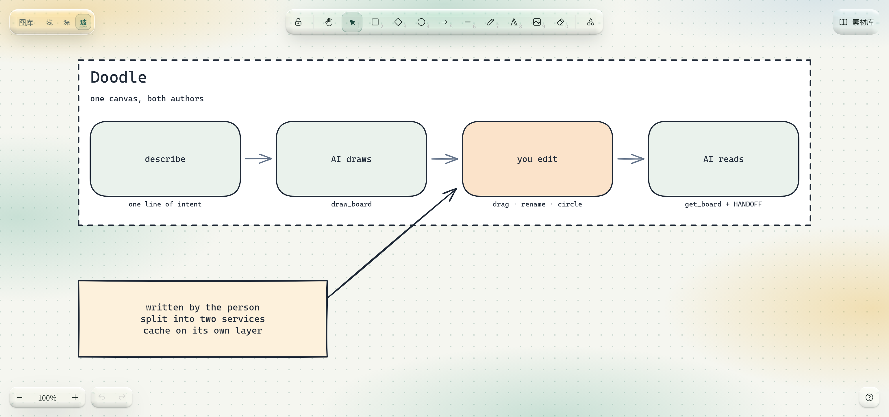

# Doodle

<p align="center">
  <strong>别再用 500 字 Prompt 硬描架构和界面草图了。</strong><br/>
  一张本地优先的<strong>人机双向 Excalidraw 画板</strong>：你和 AI 共用同一块无限画布，互相画、互相改、意图通过 MCP 实时同步。
</p>

<p align="center">
  <a href="https://www.npmjs.com/package/doodle-mcp"></a>
  <a href="https://github.com/2648782102/Doodle/blob/master/LICENSE"></a>
  <a href="https://github.com/2648782102/Doodle/actions"></a>
  <br/>
  <strong>简体中文</strong> | <a href="README.en.md">English</a>
</p>

> 一张本地优先的双向画板：人和 AI 都能在上面画图表达意思，并读取对方留下的视觉上下文。

<p align="center">
  
</p>

Doodle 只有一个内核：**人和 AI 共用的无限画板**。AI 通过 MCP 工具在 Agent 里画，人直接在画布上画；任何一方都能接着改，画板本身就是沟通媒介。对话仍留在宿主聊天里——Doodle 不创建第二套会话。

```text
AI 用 draw_board 画  ──▶  你在 Excalidraw 上直接拖拽 / 改字 / 画箭头 / 涂鸦圈重点
         ▲                                                      │
         │                                                      ▼
AI 读取 HANDOFF 增量  ◀──  终态同步进当前对话上下文（或点击「通知 Agent」）
```

对外只有两个入口：**直接 MCP / `npx`**（任意宿主，不必 clone）和 **Codex 插件**（推荐给 Codex 用户，一条命令）。宿主能力分三层：四个工具始终可用；支持 MCP Apps 时把同一张画布显示在对话旁；支持 `updateModelContext` / `sendMessage` 时增加自动同步和短提醒。宿主不渲染画布时，`get_board` 返回的 `PANEL_URL` 是本地兜底页。

自 `0.8.0` 起自研 DOM 画布已移除，**Excalidraw 是唯一的编辑/渲染画布**。Board v1 仍是唯一持久状态和 AI 权威入口，Excalidraw 元素只由它派生，不存在第二份画布状态。

## 为什么选择 Doodle？

市面上大多数画图类 MCP 都是**单向输出**：AI 吐出一张图，哪里不对，你还是得回到聊天框里打一大段字让它重画。Doodle 把“人改画布”真正接回了 Agent 循环：

- **真正的双向 `HANDOFF` 增量回传**：你在画布上拖动、改字或涂鸦删改后，Doodle 会自动计算**只有人改过的部分**（过滤 AI 自己上一轮写入的噪音），把终态同步回 Agent。
- **极致克制的 4 个工具**：只有 `get_board`、`show_board`、`draw_board`、`scan_project`。相比动辄 20+ 工具的 MCP Server，大幅节省模型上下文 Token。
- **零配置、纯本地、MIT 开源**：一条 `npx -y doodle-mcp` 即开即用，**无需任何 API Key、无需登录账号、不上传云端**，状态仅保存在本地 `.doodle/board.json`。
- **全宿主可用**：支持 MCP Apps 的客户端（Codex、Claude Desktop、Cursor、VS Code）直接在对话旁内嵌画布；终端/纯文本宿主也会自动提供本地浏览器 `PANEL_URL` 兜底。
- **Excalidraw 原生体验（`0.8.0+`）**：支持手绘笔迹（按下即出墨）、只擦笔迹的橡皮擦、框选批量整理、`Ctrl/⌘+V` 贴图、本地「图库」管理多张可编辑画板，以及导出 PNG / JPG / SVG 分享快照。

### 和同类画图 MCP 对比

| 维度 | **Doodle (`doodle-mcp`)** | 同类画图 MCP |
|---|---|---|
| **交互方向** | **人机双向**（人改画布后通过 `HANDOFF` 与 `updateModelContext` 回传 AI） | 多数为**AI 单向出图**（人改后通常需要截图或文字重述） |
| **MCP 工具数** | **4 个**（上下文开销极低） | 常见 15–26+ 个 |
| **安装与密钥** | **`npx -y doodle-mcp` 零配置**，无需 API Key | 部分需配置大模型 Key 或克隆本地构建 |
| **命令行宿主兜底** | 自带本地 `PANEL_URL` 网页画板兜底 | 多数无独立回退页面 |
| **开源协议与维护** | **MIT 协议**，持续迭代 | 部分仓库缺少 License 或已停更 |

## 30 秒上手

**方式一：任意 MCP 宿主（`npx -y doodle-mcp`，无需 clone 仓库）**

把下面对应客户端的零配置片段加入宿主配置（也保存在 [examples/mcp-config/](examples/mcp-config/)），重启 MCP 会话后对 AI 说：**「打开 Doodle 画板，我们先用画板交流。」** 这条路径不需要 clone 仓库，也不等于公共插件目录发布。

<details open>
<summary><strong>Claude Code（终端一行命令）</strong></summary>

```bash
claude mcp add doodle -- npx -y doodle-mcp
```

</details>

<details>
<summary><strong>Cursor（<code>.cursor/mcp.json</code> 或 <code>~/.cursor/mcp.json</code>）</strong></summary>

```json
{
  "mcpServers": {
    "doodle": {
      "command": "npx",
      "args": ["-y", "doodle-mcp"]
    }
  }
}
```

</details>

<details>
<summary><strong>Claude Desktop（<code>claude_desktop_config.json</code>）</strong></summary>

```json
{
  "mcpServers": {
    "doodle": {
      "command": "npx",
      "args": ["-y", "doodle-mcp"]
    }
  }
}
```

</details>

<details>
<summary><strong>VS Code（<code>.vscode/mcp.json</code>）</strong></summary>

```json
{
  "servers": {
    "doodle": {
      "type": "stdio",
      "command": "npx",
      "args": ["-y", "doodle-mcp"]
    }
  }
}
```

</details>

<details>
<summary><strong>Codex CLI / App（<code>.codex/config.toml</code>）</strong></summary>

```toml
[mcp_servers.doodle]
command = "npx"
args = ["-y", "doodle-mcp"]
```

</details>

**方式二：和 AI 共用同一张画板（Codex 插件，推荐 Codex 用户）**

```bash
npm run setup:codex
```

一条命令装好依赖、构建自包含插件、注册本地 marketplace、安装 `doodle@doodle`，并打印首句提示。**开启一个新的 Codex 会话**，然后说：

```text
打开 Doodle 画板，我们先用画板交流。
```

兼容 MCP Apps 的宿主会直接显示画布，AI 先读画板再放一个起步对象。你选工具点按或拖拽即可画；双击对象改字、双击空白新建便签；空白处拖拽框选后可批量移动 / 删除 / 成组 / 整理；`Ctrl/⌘+Z` 撤销、方向键微调、`Ctrl/⌘+V` 粘贴图片。左上角「图库」是覆盖式抽屉，不挤压 Excalidraw 工具栏，支持保存/切换可编辑 JSON 画板，也可导出 PNG / JPG / SVG 分享快照。人画完后宿主会同步终态，也可点「通知 Agent」发一句短提醒。宿主不显示画布时，向 AI 要 `PANEL_URL`。

**方式三：只想自己画两笔（不需要 AI）**

```bash
npm run doodle
```

启动本地画板并打开浏览器，终端里印出地址和几个基本手势；关掉终端就停止。空画板首次打开有可关闭的引导卡。

## 四个 MCP 工具

| 工具 | 权限标注 | 用途 |
|---|---|---|
| `get_board` | 只读 | 读取共享画布。首次返回完整画图规范，之后自动精简；传 `since_revision` 只返回变化对象并附 `HANDOFF`（人改了什么，不含 AI 自己的改动）。只读，默认第一步 |
| `show_board` | 只读 | 在对话旁打开可交互画布，回复中也直接给出 `PANEL_URL`（文本宿主据此打开本地画板）。用户要看或要改时使用 |
| `draw_board` | 写入（可覆写） | 写入面：新增、精确更新、删除、确定性布局、连接线、变体/角色/样式/层级，以及 `library` 图库操作。`diagram` 用语义节点/边追加一张图，`replace: true` 才整张重画 |
| `scan_project` | 只读 | 可选只读扫描项目结构，返回有界相对路径与 `file:line` 证据。不写文件、不自动画图 |

`show_board` 与 `scan_project` 都不创建图库、不改会话、不授权代码变更。

## 安装与配置

**Codex 插件**：`npm run setup:codex` 只在你主动运行时调用 Codex CLI（`npm install` → `npm run build` → `codex plugin marketplace add` → `codex plugin add doodle@doodle`）。重复运行安全，`--dry-run` 只预览命令。插件包装的是同一个自包含 stdio MCP 服务，不依赖仓库里的 `dist/` 或绝对路径。`npm run build:submission` 生成提交审核用的 ZIP；公共插件目录发布还需 OpenAI 侧资格与审核，材料见 [docs/SUBMISSION.md](docs/SUBMISSION.md)。

**直接 MCP stdio**：发布版用 `npx -y doodle-mcp`，本地检出可用 `node dist/index.js`（先 `npm run build`）。默认自动选空闲端口、隔离状态目录，并从启动环境推断工作区；只有宿主在项目外启动时才需要 `DOODLE_WORKSPACE_ROOT`。

> 截至 `0.9.1`，npm 的 `latest` 仍是 `0.8.0`：`npx -y doodle-mcp` 能启动四个工具，但还没有本版本的首用体验修复。需要 `0.9.1` 时用上面的 `npm run setup:codex` 安装 Codex 插件或从本地检出构建；npm 发布需要维护者完成 2FA 验证。

| 变量 | 默认值 | 说明 |
|---|---|---|
| `PREVIEW_PORT` | 空闲端口 | 固定本地画板 HTTP 端口；未设置或为 `0` 时自动选择 |
| `PREVIEW_HOST` | `127.0.0.1` | 本地监听地址 |
| `OUTPUT_DIR` | plugin data / `.doodle-data` / `./output` | 画板状态目录 |
| `DOODLE_WORKSPACE_ROOT` | 包根目录 | `scan_project` 的目标工作区 |
| `LOG_LEVEL` | `info` | stderr 日志级别 |

状态文件是所选目录下的 `.doodle/board.json`（version 1，独立状态，应忽略，勿提交）。`AI_DRAW_WORKSPACE_ROOT` 与旧的 `output/.ai-draw/board.json` 仅作只读兼容保留。

`PANEL_URL` 属于当前 MCP server 进程，宿主退出即失效——这是正常生命周期。需要脱离会话的预览就运行 `npm run preview:board`（只起画板 HTTP 服务，不注册工具、不装后台服务，`Ctrl+C` 停止）。

## 开发

```bash
npm install
npm run check     # 完整验收：lint / build / test / 仓库守卫 / 插件守卫 / doctor / 打包
npm run doctor
npm run preview:board
```

新增或移除 MCP 工具、协议字段、插件打包或安全边界时，必须同步 `AGENTS.md`、架构、决策、测试、示例、CI 与两个离线守卫。四个工具都带显式 MCP annotations：`get_board` / `show_board` / `scan_project` 只读、非破坏、封闭本地，`draw_board` 是可删除或覆盖对象的破坏性写入。

## 文档

完整索引在 [docs/README.md](docs/README.md)。常看的几个：

| 想了解 | 看这里 |
|---|---|
| 产品定义与边界 | [docs/PRODUCT_DIRECTION.md](docs/PRODUCT_DIRECTION.md) |
| 怎么让 AI 画好图 | [docs/DIAGRAM_GUIDE.md](docs/DIAGRAM_GUIDE.md) |
| 源码结构、HTTP 与安全模型 | [docs/ARCHITECTURE.md](docs/ARCHITECTURE.md) |
| 目标、验收与实测结果 | [docs/GOALS.md](docs/GOALS.md) · [docs/EXCALIDRAW_COMPARISON.md](docs/EXCALIDRAW_COMPARISON.md) |
| 当前有效的技术决策 | [docs/DECISIONS.md](docs/DECISIONS.md) |
| 出问题先看这里 | [docs/TROUBLESHOOTING.md](docs/TROUBLESHOOTING.md) |
| 安全 / 隐私 / 条款 | [SECURITY.md](SECURITY.md) · [PRIVACY.md](PRIVACY.md) · [TERMS.md](TERMS.md) |
| 给 AI coding agent 的操作手册 | [AGENTS.md](AGENTS.md) |

英文版快速上手见 [README.en.md](README.en.md)。版本记录见 [CHANGELOG.md](CHANGELOG.md)，路线图见 [ROADMAP.md](ROADMAP.md)。

## License

MIT. See [LICENSE](LICENSE).
